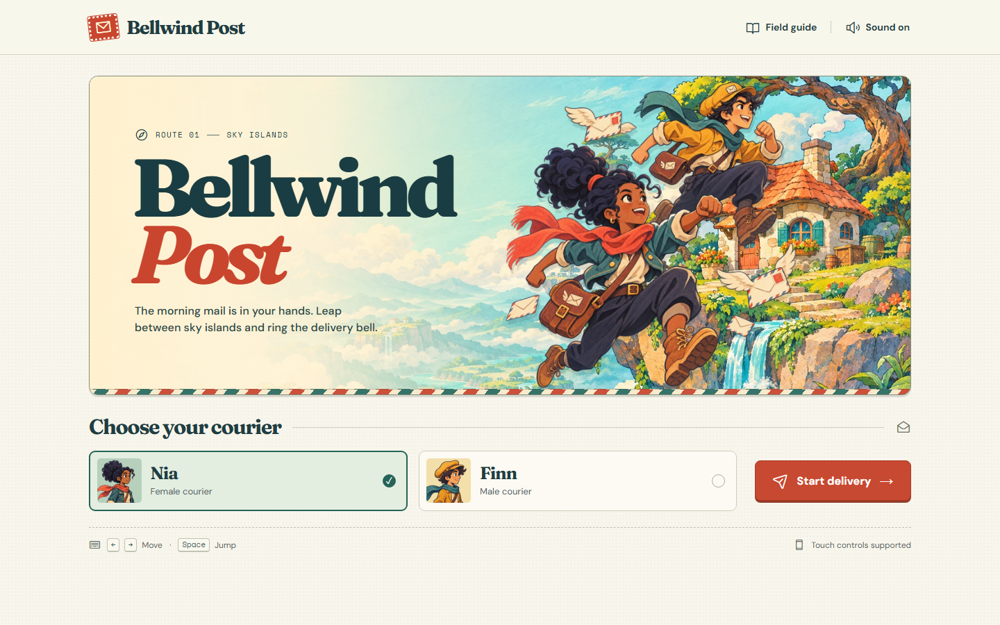

# Bellwind Post

A hand-painted browser platformer about two postal couriers and a mail route across the sky islands. Choose Nia or Finn, collect up to 12 winged stamps, and ring the brass bell. Both couriers have identical movement and collision rules.



## Play locally

Use Node.js 22.12 or later and npm. From the repository root run:

```sh
npm ci
npm run dev
```

Open the local address printed by Vite. The artwork, sound effects, and fonts run locally. To try the production build, run `npm run build` followed by `npm run preview`.

| Action | Keyboard | Touch |
| --- | --- | --- |
| Move | Left / Right or A / D | Hold a direction |
| Jump | Space, Up, or W | Press Jump with a second finger |
| Pause | Escape | Pause button |

Tap jump for a low hop or hold it for height. Stomp puffbeetles from above. Crossing the windmill activates a checkpoint. A fall or side hit costs one of three lives. Collected stamps stay in the bag when you respawn.

## Verify

```sh
npm run lint
npm run typecheck
npm test
npm run build
npx playwright install chromium
npm run test:e2e
```

Simulation tests run at a fixed 60 Hz, including a route that collects every stamp. Browser tests drive keyboard and multi-touch controls through real deliveries and cover pause, retry, character selection, and game over.

## Artwork

Built-in ImageGen generated the illustrated sprites, portraits, title artwork, scenery, and terrain. Final assets are in [public/art](public/art). The model ID is unavailable from the built-in tool. See the [character and prop prompts](docs/character-art.md) and [environment prompts](docs/environment-art.md).
