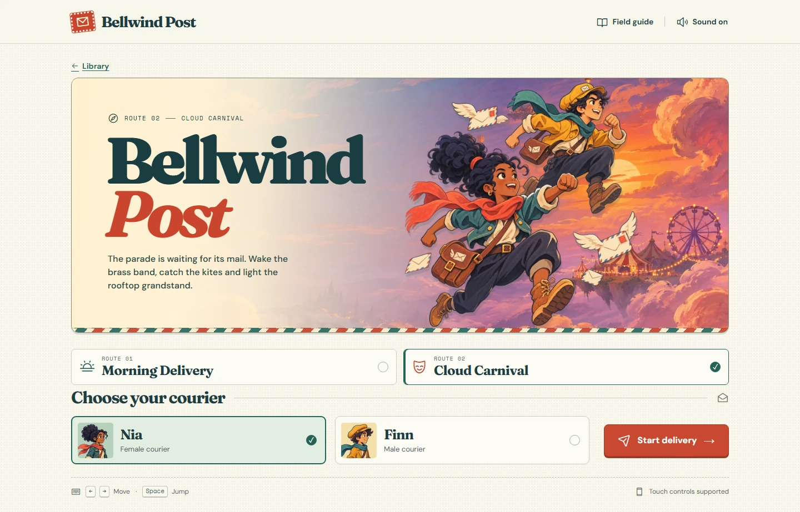
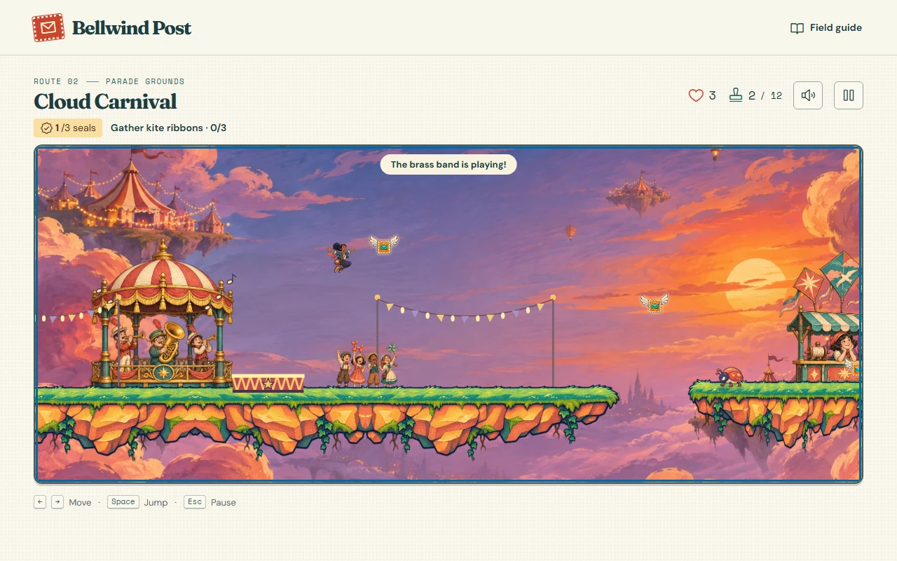
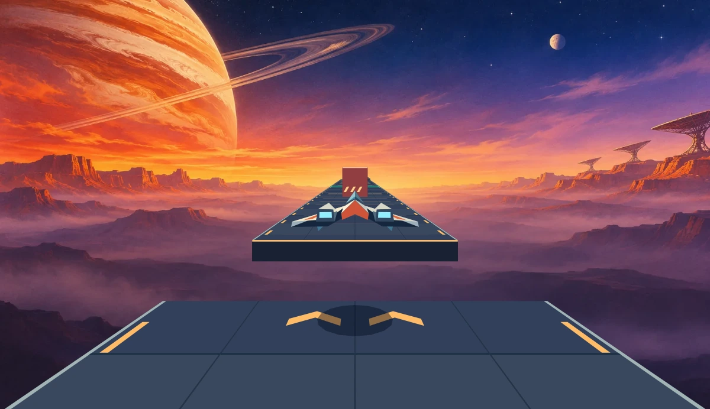

# Orbit Arcade

Orbit Arcade is a two-game browser arcade for keyboard and touch. Open the library to choose a game, or bookmark either game directly.

| Page | Production path |
| --- | --- |
| Game library | `/mymario/` |
| Bellwind Post | `/mymario/games/bellwind-post/` |
| Aphelion Run | `/mymario/games/aphelion-run/` |

## Play locally

Use Node.js 22.12 or later and npm. From the repository root run:

```sh
npm ci
npm run dev
```

Open the local address printed by Vite for the library. The dev server serves the site at `/`. To try the production build, run `npm run build` followed by `npm run preview` and open the printed `/mymario/` address. The artwork and fonts ship with the games. Both games synthesize sound on the device.

## Bellwind Post

A hand-painted platformer about two couriers on the sky islands. Choose Nia or Finn at the dispatch desk. Both couriers can collect all 12 optional stamps on each route.



| Action | Keyboard | Touch |
| --- | --- | --- |
| Move | Left / Right or A / D | Hold a direction |
| Jump | Space, Up, or W | Press Jump with a second finger |
| Pause | Escape | Pause button |

Tap Jump for a low hop or hold it for height. Stomp puffbeetles from above. A fall or side hit costs one of three lives. Collected stamps stay in the bag when you respawn.

**Morning Delivery** starts at the hilltop post office. Cross the windmill checkpoint and ring the brass bell to unlock **Cloud Carnival** for either courier. Continue from the victory screen or choose the route at the dispatch desk. The browser remembers the unlock between visits when local storage is available.

**Cloud Carnival** gives the courier three booth seals to earn. Bounce on the bass drum at the Brass Bandstand, ride the parade float to collect three kite ribbons, and light both star pads at the Lantern Grandstand. A lower walkway lets you double back for missed ribbons. Each booth changes the scenery as you complete it. Earn all three seals and ring the rooftop bell to start the confetti finale. Booth progress survives a lost life and resets when you restart the route.



[Kite Midway on a phone](docs/screenshots/cloud-carnival-phone.webp) · [The first lantern row lit at the grandstand](docs/screenshots/cloud-carnival-grandstand.webp)

## Aphelion Run

Fly three original space roads from a rear chase view. Speed changes your jump distance. Land on marked supply strips to replenish fuel and oxygen, and line up the ship’s shadow with the next platform. Finishing a course unlocks the next and records your best clear time in this browser.



| Action | Keyboard | Touch |
| --- | --- | --- |
| Steer | Left / Right or A / D | Hold a direction |
| Change speed | Up / Down or W / S | Use + or −, then release to hold speed |
| Jump | Space | Tap Jump while steering |
| Pause / resume | Escape | Pause / Resume |
| Retry after a crash | R | Retry |

Dawn Array starts with wide roads and a full-width supply strip. Iceglass Relay offers narrow raised shortcuts in low gravity. Ember Foundry has heavier gravity and a fork between a refueling lane and a faster jump. Losing focus pauses the flight. If browser storage is unavailable, the cup stays playable and keeps times until you leave the page.

## Verify

```sh
npm run lint
npm run typecheck
npm test
npx playwright install chromium
npm run test:e2e
```

Simulation tests run at a fixed 60 Hz. Playwright builds the production site and visits the three pages under `/mymario/`. Keyboard and two-finger touch journeys unlock and finish Cloud Carnival and clear all three space roads.

The Game checks workflow tests pushes and pull requests. Before publishing the tested `dist/` artifact to [GitHub Pages](https://lubacareer.github.io/mymario/), the deploy job verifies that the commit is still the head of `main`.

## Artwork

Built-in ImageGen generated the illustrated sprites, portraits, title artwork, scenery, and planet panoramas. The racer’s ship, track and shadows are projected from game geometry. Its library cover is a gameplay capture. Final assets are in [public/art](public/art). The model ID is unavailable from the built-in tool. See the [character and prop prompts](docs/character-art.md), [Bellwind environment prompts](docs/environment-art.md), and [Aphelion panorama prompts](docs/aphelion-art.md).
